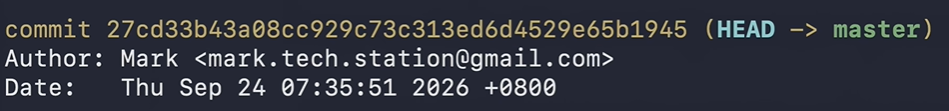
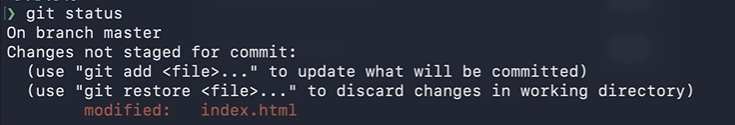
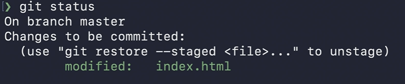
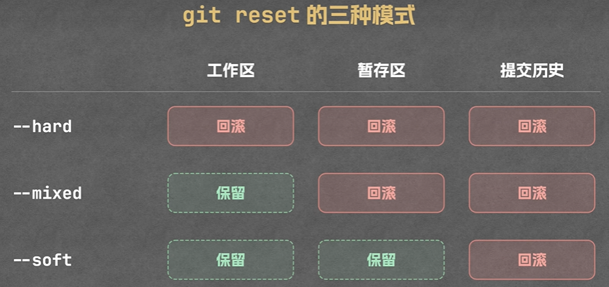
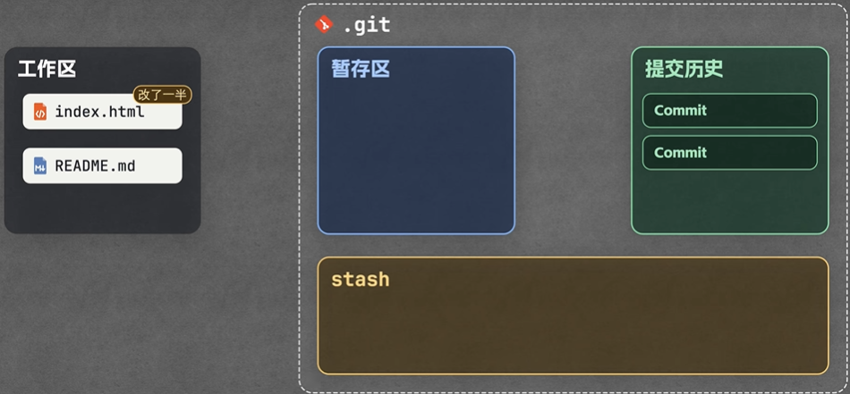
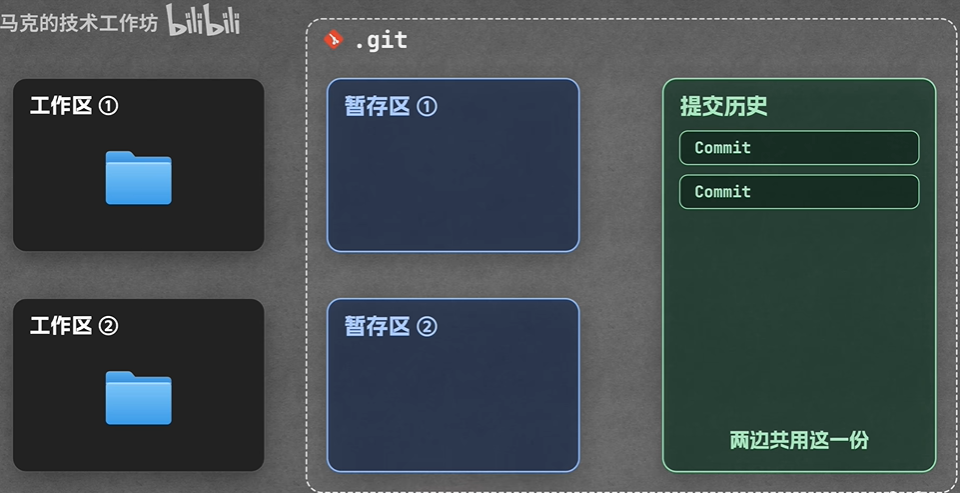

## 仓库初始化

1，初始化仓库

```
git init    #初始化仓库
```

2，提交名字和邮箱

```
git config --global user.name "<名字>"
git config --global user.email "<邮箱>"
```

3，查询状态

```
git status
```



第一条数据，凭证号，就类似身份证号

4，查询历史提交记录：


```
git log
git log --oneline #每条提交记录只显示一行内容
```


## 三个区域

工作区， 暂存区，提交历史区
工作区是我们的资料的位置，暂存区和提交历史区是在.git文件夹内

## 存档

1，从工作区提交到暂存区


```
git add <文件名>
```


2，从暂存区提交到提交历史


```
git commit <文件名>
git commit <文件名> -m "备注"   #带有备注的提交，文件名可有可无
```


3，查看具体修改内容


```
git diff
```


work tree 和 work directy 一个意思

## 回滚的3种场景

1，如果修改文件，但是还没有加入到暂存区


```
git restore <文件名1> <文件名2>       # 从工作区去掉，哪些文件需要回滚，直接追加文件名就行
git restore .   # 这个点就是当前目录所有的修改的文件都回滚
```


文件在工作区，还没提交到暂存区



文件在暂存区，还没提交到commit




2，如果放到暂存区了，但是还没有提交


```
git restore --staged <文件名>   # 从暂存区去掉
git restore --staged .         # 从暂存区去掉所有改动
```


回滚之后就到工作区了，想要再回滚就执行工作区回滚的指令

3，如果放到提交历史区了


```
git  reset --hard HEAD~1   #直接回滚到上一版本
```


指令解析：

HEAD：执行最新的commit，其实就是指针
HEAD~1：回滚到上一个commit
HEAD~2：回滚到上上一个commit

reset：重置

--hard：工作区，暂存区，提交历史，3个区域全部回滚

**git reset有三种模式：**

git reset --hard HEAD~1 全部不保留，直接到上一个版本
git reset --mixed 工作区保留。不写任何提示，默认就是这个
git reset --soft 工作区，暂存区都保留



4，新建一个反向提交


```
git revert HEAD
```


假设当前是第N个commit，执行之后会变成N+1个commit。这个N+1的commit和N-1的commit一致

解释：

1. Git 自动生成一个新 commit，把上次提交的修改反过来（加的代码删掉、删掉的代码加回来）
2. 原来的提交还在日志里，不会消失

## git的忽略文件

新建一个文件


```
.gitnore
```


## 分支

### 创建分支

1，创建分支：


```
git branch <分支名>
```


创建分支时，没有对分支名做严格的限制

### 切换分支

2，切换分支：


```
git switch <分支名>
```


下面这个指令一样的意思，是旧的


```
git checkout <分支名>
```


3，创建分支并切换过去：


```
git switch -c <分支名>
```


下面这个指令是之前的指令也可以用，但含义没上面更明确一点


```
git checkout -b feature/one-data  创建分支并且移到这个分支上
git checkout -b = git switch -c
```


4，针对于下描述命令：


```
git branch -c <分支名>
```


其实其正确用法是：


```
git branch -c <旧分支名> <新分支名>
```


这个指令的含义：是复制分支，只新建一个分支指针，不会自动切换 HEAD！，依然留在原来的分支上
正确的用法：把一个老分支复制一份，只是拷贝分支，不跳转。
5，查看所有分支


```
git branch #查看所有分支
```


### 合并分支

6，合并分支：


```
git merge <分支名>  
```


合并分支到master；前提要在master

如果是一个分支，在合并的时候直接就是把主分支HEAD移动到这一个分支的头部

如果是两个分支合并，就是先合并一个分支和上述一样，在合并疯子的时候，就是从HEAD原来的位置，一步一步合并，有冲突需要及时处理冲突，再合并

## rebase

rebase （re：重新 base：地址）

1，在一个分支上，我要拉取最新的主分支作为我的地基，其实就是头


```
git rebase master
```


2，如果中间有其他冲突，需要先解决冲突，再添加到暂存区，这时需要执行的指令：


```
git reabse --continue
```


而不是进行提交

## stash

一个临时区域，图示：



git stash 把当前的未提交的全部放到stash区域


```
git stash
```


git stash pop 把stash区域的内容全部再给到我的文件里面


```
git stash pop
```


这个stash是一个临时区域，比如我这在一个分支上写功能，还没开发完，主分支上的一个功能有点问题，需要紧急去修改一下，我就把我现在分支未完成的（因为还未完成所以也不能commit）放到stash。切换到主分支，创建一个新分支用来处理问题，新分支处理完问题再合并到主分支，再切换到我现在的分支，使用git stash pop 命令把临时的文件重新给到我的分支上

适合临时打断一下，不适合同时开发多个分支

## worktree

一个新的目录文件夹，图示：



添加一个目录分支


```
git worktree add -b feature/stats ../马克待办(统计)  master
```


查看目录


```
git worktree list
```


删除新目录


```
git worktree remove ../马克待办（统计）  #删除新目录
```


其中，中文会直接变成八进制，执行以下指令，不让它转义


```
git config --giobal core.quotePath flase
```


## Github

ssh key：有公钥和私钥之分

1，生成 ssh key：


```
ssh-keygen -t ed25519 -C "wangzhen311316@gmail.com"
```


ed25519是EdDSA 签名算法，基于 Edwards25519 椭圆曲线。（注意：它只做签名，不能用来加密；配套的 X25519 才是密钥协商，很多人搞混）。是比较好用的一种签名算法。

2，查看公钥并复制：


```
cat ~/.ssh/id_ed25519.pub
```


3，GitHub 网页添加公钥

GitHub → Settings → SSH and GPG keys → New SSH key

- Title：备注（例如：本机笔记本、家用 PC）
- Key type：Authentication key（默认）
- Key：粘贴刚刚复制的公钥
- 点击 Add SSH key 保存

4，测试 SSH 连通性：


```
ssh -T git@github.com
```


注意：

首次连接会提示确认，输入 `yes`

成功提示类似：`Hi xxx! You've successfully authenticated, but GitHub does not provide shell access.` 这句话是正常的，代表密钥验证成功！

5，github创建仓库后，上传项目

上传有两种方式，https和ssh。记得使用ssh

1）如果本地没有新项目，本地创建新项目再推送（本地从零初始化，推送到 Github 空仓库）


```
echo "# 1222" >> README.md
git init
git add README.md
git commit -m "first commit"
git branch -M master
git remote add origin https://github.com/Muttiee/1222.git
git push -u origin master
```


2）如果本地已经有项目，直接推送本地已有的项目（本地已经有代码，只是还没关联远程仓库）


```
git remote add origin https://github.com/Muttiee/1222.git
git branch -M master
git push -u origin master
```


github中默认是main，但是这里我本地主分支是名称master，可以在github中设置一下更改为master。

其实master和main都只是一个名称，没有本质区别，但是使用的时候最好统一，要么都用main，要么都用master


6，拉取远程最新代码到本地


```
git pull origin master #第一次使用
git pull #后续使用可以直接使用这个语句
```


7，克隆远程仓库到本地


```
git clone git@github.com:xxx/xxx.git  # 只执行一次：把远程仓库下载到本地（初始化拿到项目）

# 仓库已经在本地之后，更新代码：用 git pull，不再用 clone
```