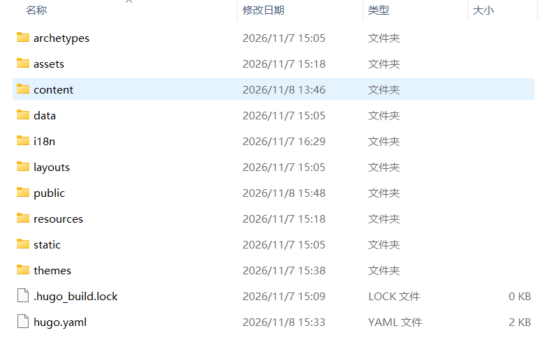
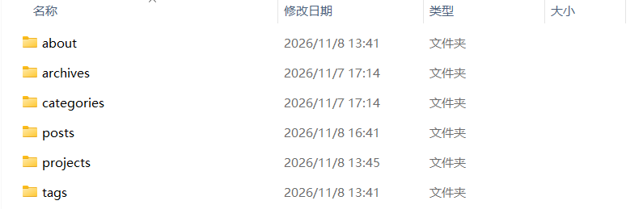
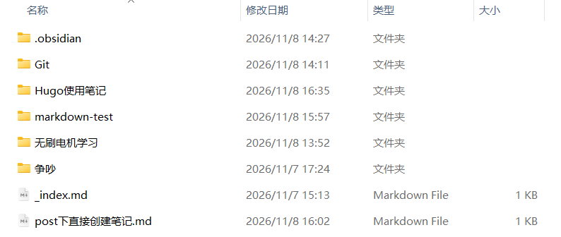

# 一、介绍
Hugo是一个建站工具，相似的还有hexo。这种都属于静态网站
还有一类是带后台的，例如Halo和WordPress。这种可以在后台书写

# 二、下载
2.1 官网进行下载Hugo

2.2 下载主题
官网有Thems，点进去之后有各种各样的主题可供选择，点开喜欢的主题，可以直接跳转到github，进行下载

# 三、使用

## 3.1 常用的指令
1，新建站点，名字随便，比如 myblog。（这里是在本地生成一个文件夹） 
```
hugo new site <文件名>
```

2，在本地运行网站
```
hugo server -D
```

## 3.2 文件解释
### 3.2.1生成的文件


1，经常用到的是context文件夹；
2，publi、resources文件夹，.hugo_build.lock文件，可以忽略掉。这些是构建网站时生成的文件。
3，hugo.ymal文件是配置文件。里面可以修改主题等其他信息，比较重要
### 3.2.2 context下的文件


1，平常要写的文件是放在posts文件夹下
2，其他文件夹
	about：关于页面
	archives：归档页面
	categories：分类页面
	projets：项目页面（目前未使用）
	tags：标签页面
### 3.2.3 posts下的文件


1，.obsidisan：因为我很这个文件将当做了obsidisan的仓库，这个是obsidisan生成的配置文件。可以直接忽略
2，以下两个，
	带下划线的是列表页（list），用来展示一堆文章的汇总目录
	不带下划线的是单篇详情页（single），它下面不能再放子文章
```
_index.md
index.md
```
3，没有图片的时候可以在posts文件夹下直接新建md格式文章
有图片的情况下，尽量新建文件夹放到一个一个里面

4，写文章的时候要有属性。三个英文字符横线就是属性
```
---
title: 在post下直接创建笔记
date: 2026-11-07
draft: false
tags:
  - "#随笔"
categories:
  - 随笔
---
```
其中：
- `title`：文章标题
- `date`：发布时间
- `draft: false`：`false` = 发布；`true` = 草稿，`hugo server -D` 才看得见，推送线上不会生成
- `tags`：标签，多条就换行 `- xxx`
- `categories`：分类，一般一篇文章放 1 个分类就够